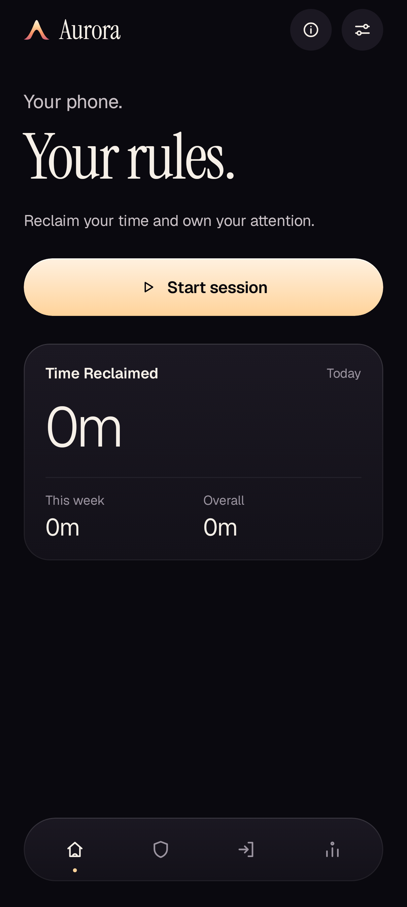
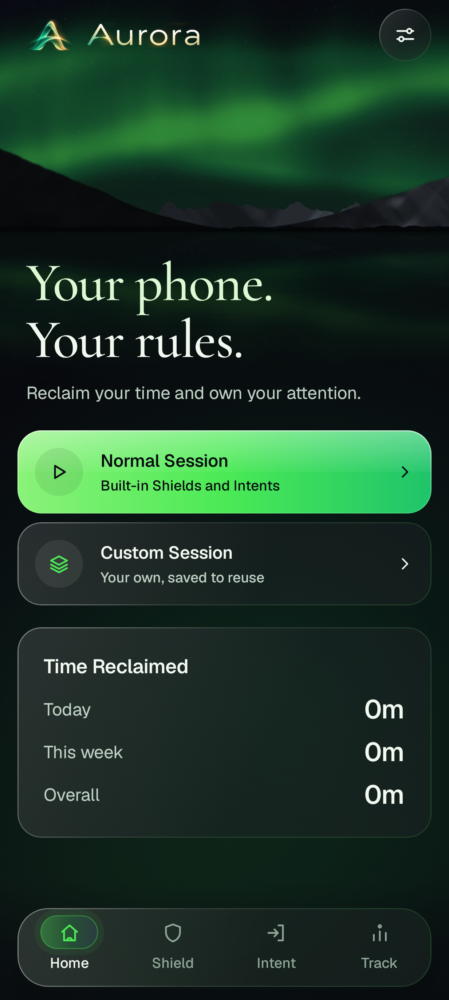
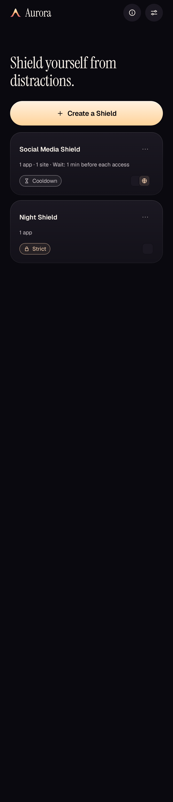
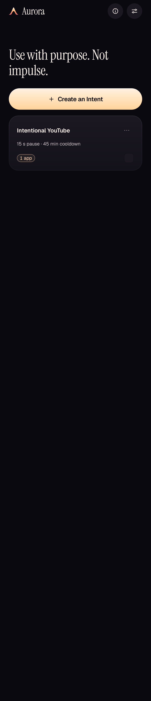
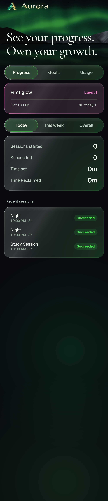

# aurora-android

Aurora is a premium digital-wellbeing app. It helps you take back control of your phone through
intentional use.

This repository is the native Android app: Kotlin and Jetpack Compose. Blocking runs on the phone.
A verified account (Google or email link) is required; the account service in `server/` holds identity,
the Free allowance for Strict and Cooldown, and Plus. No analytics and no ads. Every field sent to the
service is listed in [`docs/ACCOUNT_SYSTEM.md`](docs/ACCOUNT_SYSTEM.md).

| Home | Home, reduced motion | Shield | Intent | Track |
| --- | --- | --- | --- | --- |
|  |  |  |  |  |

[View the design preview](docs/design-studio/evidence/editorial-refinement/aurora-design-preview.png) ·
[Brand specimen](docs/design-studio/brand-specimen.html)

- Brand and design system: [`Aurora Brand Bible`](docs/design-studio/AURORA_BRAND_BIBLE.md)
- Architecture and decisions: [`docs/ARCHITECTURE.md`](docs/ARCHITECTURE.md)
- Configurations, four-tab navigation and Goals: [`docs/CONFIGURATIONS.md`](docs/CONFIGURATIONS.md)
- Roadmap to 1.0 and beyond: [`docs/ROADMAP.md`](docs/ROADMAP.md)
- Plans and limits (Aurora Free and Aurora Plus): [`docs/BUSINESS_MODEL.md`](docs/BUSINESS_MODEL.md)
- The complete product, verification and launch dependencies: [`docs/PRODUCT.md`](docs/PRODUCT.md)
- Shipping to Google Play (signing, declarations, data safety, review risks): [`docs/RELEASE.md`](docs/RELEASE.md),
  with the [store listing](docs/STORE_LISTING.md) and [privacy policy](docs/privacy-policy.html)

## Status

Home's one action is Start session: name, Shield, when, how long, review. Saved sessions start from their
own cards. Shield and Intent hold reusable presets;
Track has Progress (XP, session results), Goals and Usage (screen time). Sessions support
starting now, later, on recurring schedules or Always, with optional Focus. Always Block keeps
its commitment rules. Existing billing, data controls and optional Web & content protection remain.

What is verified, what isn't, rule precedence, and what still needs phones, Play Console and policy
review: [`docs/PRODUCT.md`](docs/PRODUCT.md). Emulator screenshots: `docs/screenshots/emulator-2026-10-29/`.

## Design pass (29 October 2026)

One First Light painting for night and day, three-step setup, a Track that leads with one verified
number, a recomposed Aurora Plus, and Aurora outside the app: an ongoing session notification (Android
16 progress style), a home-screen widget, a Quick Settings tile and an animated splash. What changed and
what still needs people or devices: [`docs/design-studio/08-ten-out-of-ten.md`](docs/design-studio/08-ten-out-of-ten.md).
Store art: `brand/tools/store.sh` renders `brand/store/out/`.

## Requirements

- JDK 17 or newer. The project was built with Temurin 21.
- Android SDK with **platform 37** (compile) and build-tools 36.x. Target SDK is 36 and min SDK is 26.
- Use the Gradle wrapper that comes with the repository (Gradle 9.8.2). Android Gradle Plugin is 9.5.0 and Kotlin is 2.4.21.

To use Android Studio, open the folder; it fetches everything it needs. To use the command line only,
follow these steps:

```sh
sdkmanager "platform-tools" "platforms;android-37.0" "build-tools;36.0.0"
echo "sdk.dir=$HOME/Library/Android/sdk" > local.properties   # or set ANDROID_HOME
```

## Build, test, run

```sh
./gradlew assembleDebug        # APK in app/build/outputs/apk/debug/
./gradlew installDebug         # install on a running emulator or connected device
adb shell am start -n app.aurora/.MainActivity
```

### Checks

CI (`.github/workflows/android.yml`) runs these on every push and pull request. Run the same
locally before pushing:

```sh
./gradlew testDebugUnitTest    # unit tests, Robolectric UI tests, and a render of every screen
./gradlew lintDebug            # Android lint; new warnings are errors (baseline: app/lint-baseline.xml)
./gradlew assembleDebug assembleRelease
```

Installable builds need the sign-in configuration (`docs/ACCOUNT_SYSTEM.md`). CI has none, so it passes
`-Paurora.skipSignInCheck=true`; APKs built that way can't sign anyone in, so never ship one.

These need a device or the local baselines, so CI doesn't run them:

```sh
./gradlew connectedDebugAndroidTest   # the same UI tests on a running emulator (overwrites Aurora's app data)
./gradlew verifyRoborazziDebug        # compare every screen with app/src/test/screenshots/ (macOS baselines)
./gradlew recordRoborazziDebug        # re-record the baselines after an intended UI change
```

To try Insights without going through Settings, grant Usage access to a debug build:

```sh
adb shell appops set app.aurora GET_USAGE_STATS allow
```

## Project layout

```
app/src/main/java/app/aurora/
  data/            preferences (DataStore), installed apps, screen time, special access, formatting
  plan/            Aurora Free and Aurora Plus limits, and the Lockdown budget (pure Kotlin)
  ui/theme/        colours, type, spacing, radius, motion tokens
  ui/components/   the Aurora design system
  ui/<screen>/     onboarding, home, protect, focus, insights, settings
app/src/test/       unit tests, screenshot tests and their baselines (screenshots/)
app/src/sharedTest/ UI tests that run under Robolectric and on a device
docs/              BRAND.md, ARCHITECTURE.md, ROADMAP.md, BUSINESS_MODEL.md, ENFORCEMENT_FEASIBILITY.md,
                   screenshots, font licence
```

Instrument Serif and Geist are bundled under the SIL Open Font License (`docs/instrument-serif-OFL.txt` and
`docs/geist-OFL.txt`).
