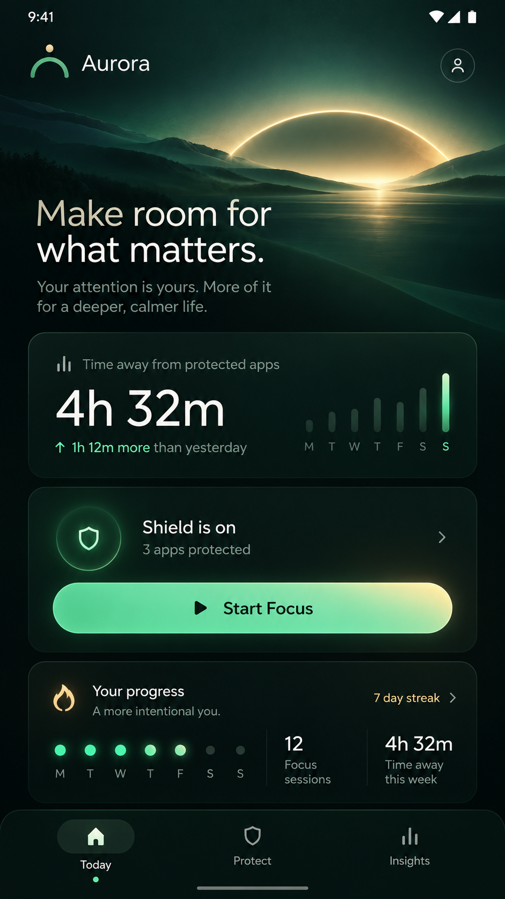
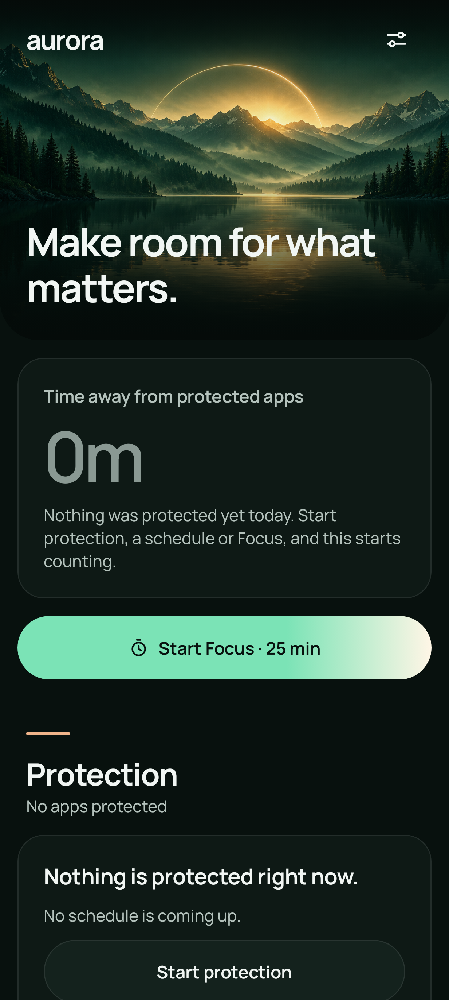
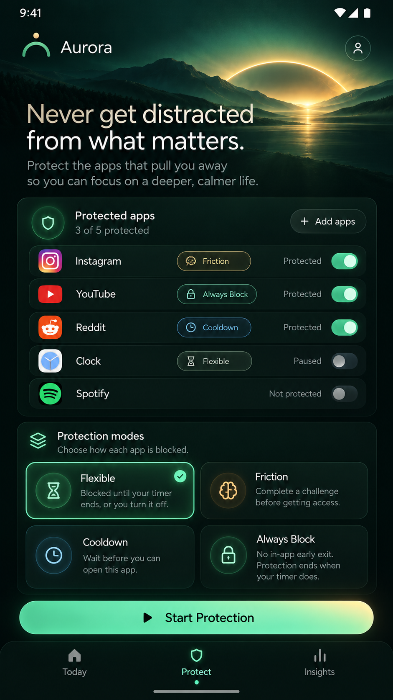
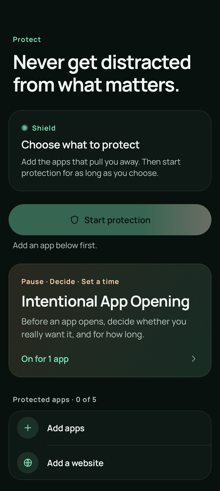
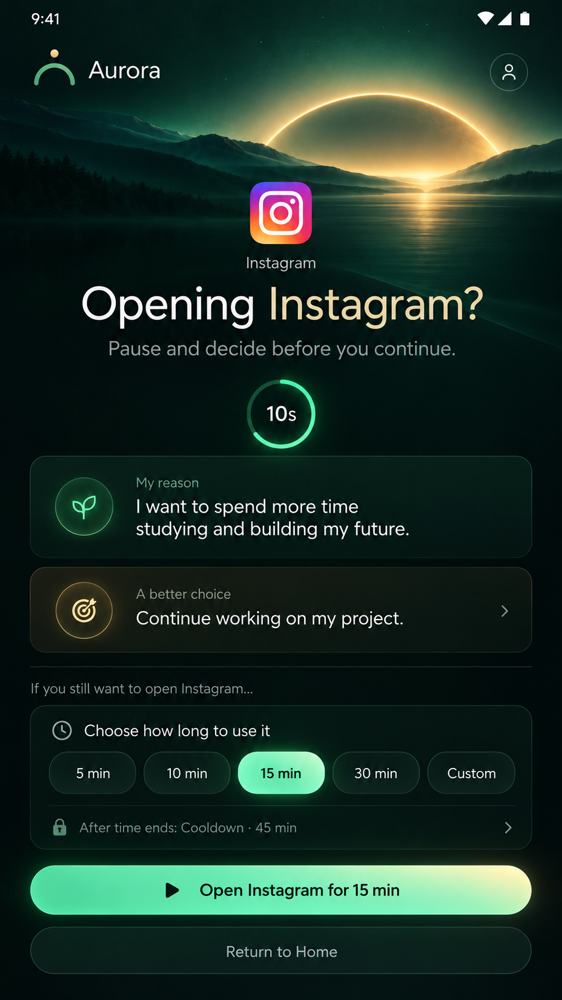
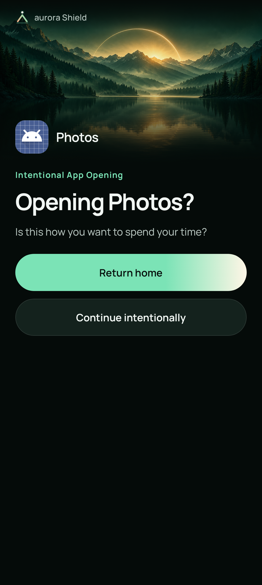
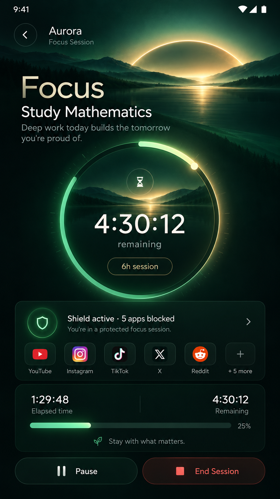
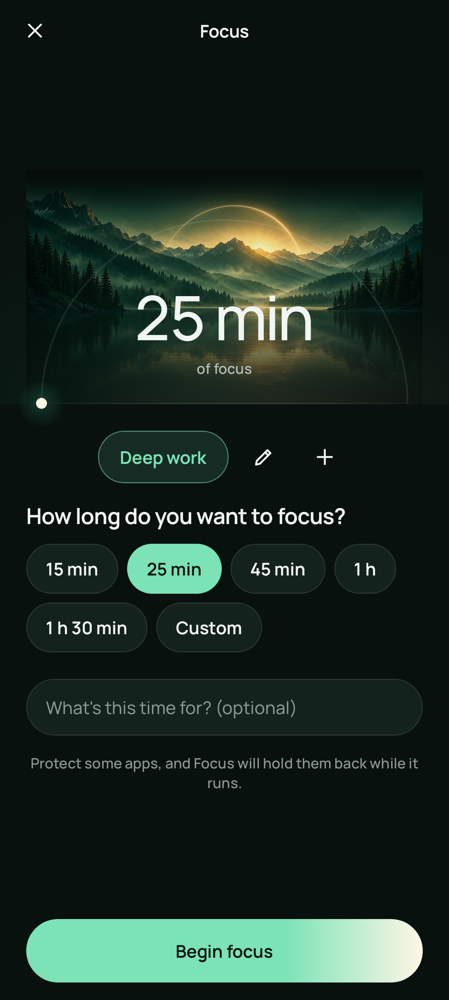
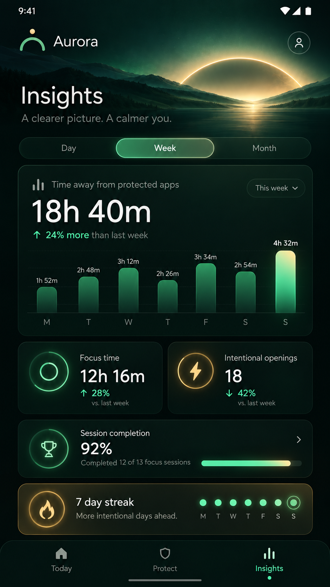
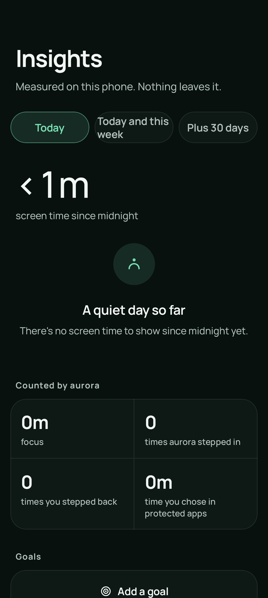

# Aurora visual review

29 October 2026. The left column contains the saved concept references. The right column contains native Compose content from the current verified dark baselines. Real emulator and Redmi captures, including navigation bars, are linked from [REINVENTION_VALIDATION.md](REINVENTION_VALIDATION.md). Baselines render content directly, so the navigation host's bottom tabs are absent from those images.

| Screen | Saved reference | Current native content |
| --- | --- | --- |
| Today |  |  |
| Protect |  |  |
| Intentional App Opening |  |  |
| Focus setup |  |  |
| Insights |  |  |

## What matches, and what differs

The shared dark emerald atmosphere, mountain/lake first-light art, golden horizon, native large headings, restrained borders, pill actions and separate protection/progress hierarchy now carry across the main surfaces. The art is an original reusable background with no baked-in UI. Light mode has a paper palette; Shield retains its night setting.

These are not pixel-identical reproductions. The reference viewport is shorter than the native 411 × 914 dp test viewport. Reference numbers, app choices and charts are illustrative; the current screens show actual saved state, measured data, empty or unavailable states. Focus setup is shown here rather than the reference's running timer. The intent test fixture uses Photos. The First Light mark follows the established vector geometry instead of replacing the icon system with a raster logo.

Today uses a growing hero, so its exact height follows font scale. It retains the source-of-measurement disclosure and places the decorative image apart from the data-driven progress Light. These are intentional adaptations to real content and accessibility, not a claim that sample content was implemented as measured behaviour.

## Accessibility and rendering checks

All ten content/Shield snapshots pass independent comparison in light, dark, 200% font and reduced motion. Reviewed large text for wrapping and scrolling, including the Shield action area and Settings controls. Native emulator onboarding was captured in light, dark and 200% font. These checks do not replace real TalkBack review; that remains a launch gate.
